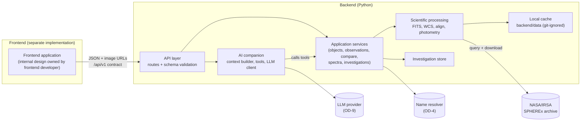
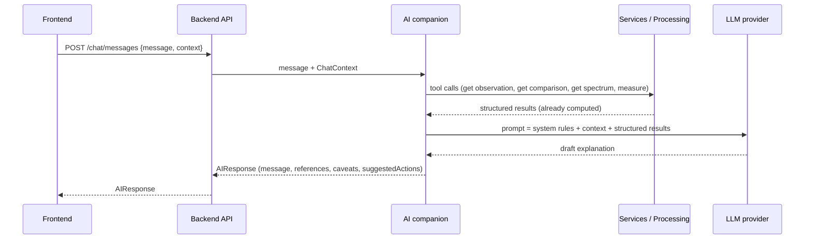

# Architecture

> Status: **draft v0.1**. Shared source of truth with the other docs in `docs/`.
> Open decisions are tagged `OD-n` and listed in [INTEGRATION_PLAN.md](INTEGRATION_PLAN.md#open-decisions).

## 1. Current repository state

At the time of writing the repo contains only the initial skeleton: `README.md`, `.gitignore`, and empty `frontend/`, `backend/{data,processing,api,tests}/`, `docs/`, `.github/workflows/` directories (each with a `.gitkeep`). There is **no application code, no dependency manifest, and no chosen framework**.

What is established so far (and preserved here):

| Fact | Source |
|---|---|
| Project is a web app with a separate `frontend/` and `backend/` | README, directory layout |
| Backend is expected to be Python (FITS/astronomy tooling); framework not chosen | `.gitignore` is Python + web oriented; README says "Python + web" |
| Large data (FITS, HDF5, NetCDF) is never committed; `backend/data/` is git-ignored | `.gitignore` |
| Secrets live in `.env` files, never committed | `.gitignore` |
| Two developers on separate branches (`front-end` exists; backend branch name is undecided, OD-10) | git remotes |

Everything else (frontend framework, backend web framework, database, hosting, LLM provider) is **undecided** and listed as an open decision. Nothing in these docs requires a particular choice for those.

## 2. System overview



Solid arrows are runtime calls. The frontend talks to the backend only through the API contract (or mock responses that follow it). Only the backend talks to IRSA, resolvers, and the LLM.

## 3. Responsibilities

### Frontend
Owned and designed entirely by the frontend developer. At the system boundary:
- It presents the product and handles user interaction.
- It consumes data only through the contract in [FRONTEND_BACKEND_CONTRACT.md](FRONTEND_BACKEND_CONTRACT.md) (real API or mock responses with identical schemas).
- It does **not** parse FITS, compute scientific results, call IRSA, call an LLM, or hold API keys. Those are backend responsibilities.

How the frontend is structured internally (components, state, routing, mock mechanism, styling) is not specified by this repository's shared docs.

### Backend
- IRSA querying and download, local caching.
- FITS parsing, WCS handling, alignment, comparison, photometry, spectral extraction.
- Quality and compatibility assessment.
- The HTTP API defined in [FRONTEND_BACKEND_CONTRACT.md](FRONTEND_BACKEND_CONTRACT.md).
- Investigation persistence.
- The AI companion (context assembly, tool calls, LLM interaction).

## 4. Data flow

```text
IRSA archive
   │  (1) search/query by position/time/release; download FITS     [backend]
   ▼
Raw observation files  ──cached in backend/data (git-ignored)
   │  (2) parse FITS + headers, read WCS, read flag/uncertainty planes   [processing]
   ▼
Processed data  (calibrated arrays as delivered, normalized metadata)
   │  (3) align, compare, measure, extract spectra, assess quality        [processing]
   ▼
Derived results  (ComparisonResult, Measurement, SpectralData)
   │  (4) render display images, serialize to contract models             [api]
   ▼
JSON + image URLs ──HTTP (contract)──► frontend
   ▲
   │  (5) derived results + context are passed to the AI companion        [ai]
   └── AIResponse (explanation, references to results, caveats)
```

The four tiers of information (raw → processed → derived → AI explanation) are kept distinct end to end. See [SCIENTIFIC_DATA_PIPELINE.md](SCIENTIFIC_DATA_PIPELINE.md).

## 5. Backend module boundaries

Kept deliberately small for a 48-hour build. Directory names under `backend/` already exist except where noted.

| Module | Location | Responsibility | May depend on |
|---|---|---|---|
| API | `backend/api/` | HTTP routes, request/response validation against contract models, error mapping. **No scientific logic.** | services, ai |
| Services | `backend/api/` or a new `backend/services/` (OD-2) | Orchestrate use cases: resolve object, list observations, build comparison, build spectrum, CRUD investigations. | processing, store |
| Processing | `backend/processing/` | Pure(ish) scientific functions: IRSA client, FITS reader, WCS helpers, alignment, photometry, spectral assembly, quality checks, image rendering. Testable without HTTP or LLM. | external libs only |
| AI companion | new `backend/ai/` (proposed, not yet created) | Context builder, tool definitions, LLM client, response shaping. Tools call **services**, never raw FITS. | services |
| Data cache | `backend/data/` | Downloaded/derived files. Git-ignored. | n/a |
| Tests | `backend/tests/` | Unit tests for processing, contract tests for API. | all |

Rules:
1. `processing` never imports from `api` or `ai`.
2. The AI companion gets structured results through service calls. It never opens FITS files and never does arithmetic that matters scientifically.
3. API layer response shapes equal the contract models exactly; no ad-hoc fields.

## 6. Frontend boundary

The frontend's internal architecture is the frontend developer's decision (OD-1) and is intentionally not documented here. The only shared requirements are:

1. The frontend can run entirely on mock data. Mock data follows the contract schemas exactly.
2. Moving from mock data to the real backend changes no shared data model.
3. The frontend depends on the contract, never on backend internals.

## 7. Where the AI companion fits



Separation of concerns:

| Concern | Lives in | Notes |
|---|---|---|
| Scientific computation | `processing` | Deterministic, tested, produces numbers + uncertainty + quality. |
| API logic | `api` / services | Validation, orchestration, persistence, error mapping. |
| Conversation | `ai` | Prompting, tool selection, tone. The frontend owns the *presentation* of the companion (personality, animation); the backend owns the *content*. |

The LLM may explain and contextualize results it was given. It must not compute, invent measurements, or read raw FITS. Details and limits: [SCIENTIFIC_DATA_PIPELINE.md §9](SCIENTIFIC_DATA_PIPELINE.md#9-what-the-ai-companion-may-conclude).

## 8. Deployment (eventual)

Nothing is decided (OD-11). Recommended shape, to confirm:

- **Frontend**: built to static assets, served by any static host or by the backend.
- **Backend**: a single Python service (one container is enough). Needs outbound network to IRSA, the name resolver, and the LLM provider, plus a persistent volume for `backend/data/` cache and the investigation store.
- **Routing**: frontend and backend on one origin with `/api/v1` proxied to the backend avoids CORS; otherwise the backend must allow the frontend origin explicitly.
- **Secrets**: LLM key and any other credentials are backend environment variables only. They never reach the browser and are never committed.
- **Demo resilience**: because IRSA downloads can be slow, pre-warm the cache for the demo objects and the frontend can fall back to contract-conformant mock responses if the developers agree to do so.
- **CI**: `.github/workflows/` is empty. Add checks only when there is code to check.

## 9. Non-goals (hackathon scope)

No auth/accounts, no multi-tenant storage, no background job queue (long operations use polling on a status field), no microservices. Revisit only if a concrete need appears.
