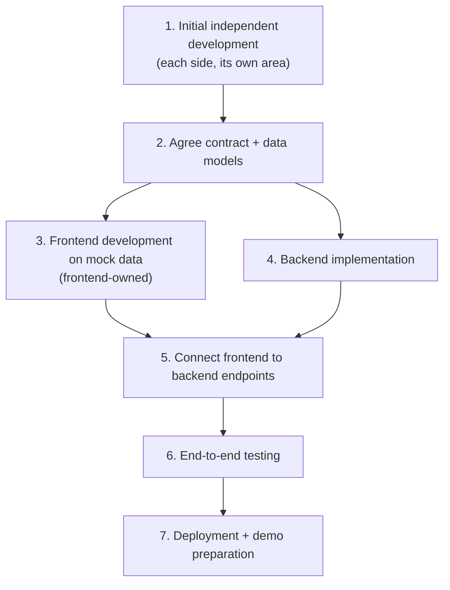

# Integration Plan

> Contract version **0.1.0 (draft)**. For a 48-hour hackathon. This plan covers only the **shared** path: contract, backend delivery, connecting, testing, deployment. The frontend developer plans their own internal work.

## Phases and dependencies

Phases 3 and 4 run **simultaneously** and independently.

| # | Phase | Shared content | Depends on |
|---|---|---|---|
| 1 | Initial independent development | Backend: IRSA access spike (find and download SPHEREx data for one object), FITS and WCS read, one rendered image. Frontend: its own choice. | nothing |
| 2 | Agree contract and data models | Both read the contract and data models, settle the blocking open decisions (▲ below), merge agreed docs to `main`. Exit: each developer can implement their side without further questions. | 1 (informs it) |
| 3 | Frontend on mock data | Frontend-owned. Only shared requirement: mock responses match the contract exactly. | 2 |
| 4 | Backend implementation | Implement the contract operations with real data. Suggested order, adjustable to what IRSA access allows: health + error envelope; object search/resolve; observations; images + pixel-to-sky; comparison; measurements and spectrum; investigations; AI companion (which uses the earlier results as tools). Backend tests validate responses against the contract. | 2 |
| 5 | Connect | Frontend points its data access at the backend. Mismatches are fixed in the **contract first**, then in code. May be done operation by operation. | 3 and 4 (for the operations being connected) |
| 6 | End-to-end testing | Walk the demo script repeatedly; test failure modes (archive slow or unreachable, empty results, `processing` polling, `not_comparable`, AI unavailable). Check every scientific value shown has units and uncertainty or an explicit "not available", plus caveats. | 5 |
| 7 | Deployment and demo prep | Deploy per OD-11, pre-warm the cache for demo objects, record a backup demo, freeze the contract (bug fixes only). | 6 |

## What can happen simultaneously

| Frontend developer | Backend developer | Needs |
|---|---|---|
| Their own app work | IRSA spike, FITS/WCS | nothing |
| Work on mock data | Endpoint implementation + tests | agreed contract |
| Chat experience on mock `AIResponse` | AI tools, prompts, context building | agreed `ChatContext`/`AIResponse` |
| Investigation experience on mock data | Investigation storage | agreed `Investigation` and OD-7 |

## Open decisions

▲ = settle in Phase 2 before implementing against the contract. "Owner" is who proposes; both must be informed.

| ID | Decision | Owner | Blocking? |
|---|---|---|---|
| OD-1 | Frontend framework, build tooling, language (the contract is expressed in TypeScript) | Frontend | internal to frontend |
| OD-2 | Backend web framework (Python assumed from repo setup) | Backend | internal to backend |
| OD-3 | Where shared TS types and example JSON live (suggestion: a `shared/contract/` directory; not created) | Both | ▲ |
| OD-4 | Object name resolver service | Backend | no |
| OD-5 | Image delivery policy (size, single raster vs tiles) | Both | ▲ |
| OD-6 | Pixel↔sky conversion on server (current draft) or client | Both | ▲ |
| OD-7 | Investigation persistence and user identity (draft: none) | Both | ▲ |
| OD-8 | Chat streaming (draft: none) | Both | no |
| OD-9 | LLM provider/model, key handling, how "AI unavailable" is signaled | Backend | no |
| OD-10 | Backend branch name; how and when work merges to `main` | Both | ▲ |
| OD-11 | Deployment target | Both | before Phase 7 |
| OD-12 | Which SPHEREx data products/releases are in scope; how a position's spectrum is assembled | Backend | ▲ |
| OD-13 | Difference-imaging scope and wavelength-matching policy | Backend | no |
| OD-14 | `observationId` scheme (opaque but stable and mappable to the archive ID) | Backend | ▲ |
| OD-15 | Concurrent edits to an investigation (draft: last write wins) | Both | no |

## Integration readiness checklist

**Contract and models**
- [ ] Both developers have read the contract and data models; all ▲ decisions are resolved.
- [ ] Contract version is the same on both sides (the backend reports it at `GET /health`).
- [ ] Shared type/example location settled (OD-3).
- [ ] `DATA_MODELS.md` and the contract agree (no divergence found since last change).

**Backend**
- [ ] Every operation returns contract-valid JSON (automated tests).
- [ ] Error envelope used for every non-2xx response.
- [ ] Optional fields omitted, never `null`.
- [ ] Image URLs are loadable from the frontend's origin (CORS or same-origin resolved).
- [ ] Long operations return `202` with `processing` and eventually resolve.
- [ ] Missing-data cases (contract §8) use the documented representations.
- [ ] Secrets only in environment variables; none committed.
- [ ] Demo objects cached; works if IRSA is slow.

**Frontend (boundary only; internal items are the frontend developer's)**
- [ ] Frontend developer confirms their mock responses conform to the contract.
- [ ] Frontend developer confirms the contract's states (statuses, errors, missing data) are handled in their implementation.

**End to end**
- [ ] Demo script runs three times in a row without intervention.
- [ ] Failure modes tested (Phase 6).
- [ ] AI answers include `references` and `caveats`.
- [ ] Anything shown from mock data in the demo is labeled as such.

## Suggested demo script (placeholder; refine together)

1. Search for an object, then view its observations over time.
2. Open an observation and its quality information.
3. Compare two observations (blink, then difference) with compatibility checks.
4. Open the spectrum, including gaps and uncertainties.
5. Ask the AI companion about the result; show references and caveats.
6. Save to an investigation with a note.
